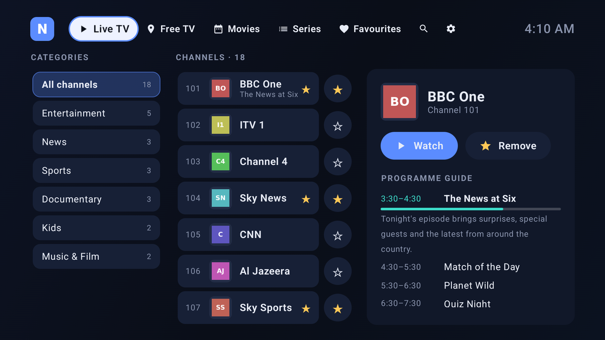
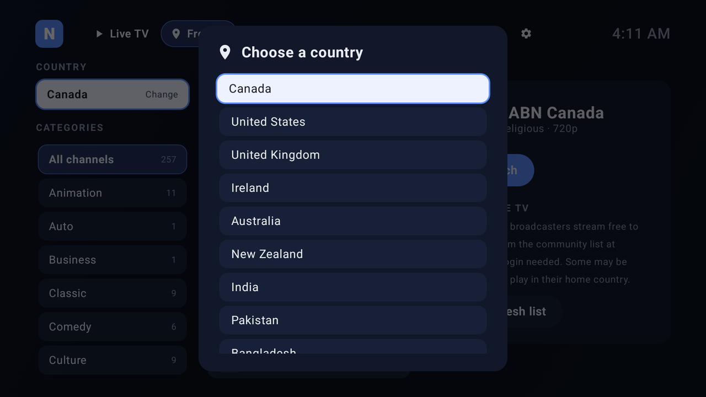
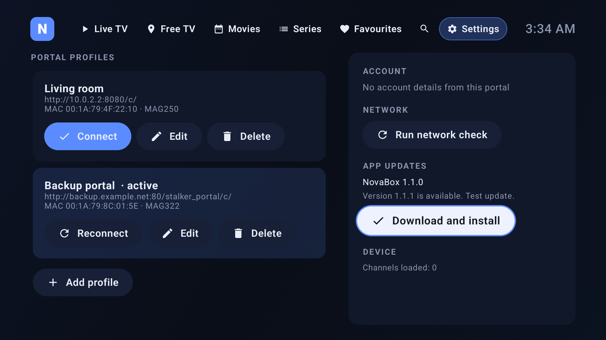

# NovaBox

An IPTV portal player for Android TV and Google TV. It logs in to Stalker / Ministra
middleware portals with a MAC address (the same kind of portal MAG set-top boxes and
STB emulator apps use) and plays live TV, films and series.

Everything works with a plain D-pad controller: **arrows, OK and Back**. No action needs
the red, green, yellow or blue buttons.

## Features

- Several portal profiles: portal URL, MAC address, STB model (MAG250 to MAG520),
  serial, device IDs, signature, optional portal login/password, time zone, custom user agent
- Live TV with categories, channel logos and a programme guide (now/next with progress)
- Films and series by category, with posters, details, seasons and episodes
- Favourites for channels, films and series, saved on the device for each profile
- Search across channels, films and series
- Account info from the portal (expiry date, plan)
- Network check (Settings → Run network check, or from the "Couldn't connect" screen): tests the TV's connection, internet access and speed, the portal's address, server and login, and a live stream, then says what to fix
- **Free TV**: channels that broadcasters stream free to the public, by country (from the
  community list at iptv-org). No portal, profile or login needed; works even with no profiles set up
- **Check for updates** (Settings → App updates): downloads the newest NovaBox from this repository and
  installs it over the current one. Profiles, favourites and settings are kept
- Stream resolution (720p, 1080p, 4K…) shown briefly in the top-right corner when a new stream starts
- Media3/ExoPlayer playback (HLS, MPEG-TS, MP4), with the portal's MAG headers sent to stream servers

## Screenshots

| | |
|---|---|
|  Live TV and the tab bar |  Free TV: no login needed |
|  Free TV country picker |  Free TV categories |
|  Settings with App updates |  An update is available |
|  Android's update prompt |  Connection error, with a Free TV shortcut |

## Controls

| Where | How |
|---|---|
| Top tab bar | Live TV · Free TV · Movies · Series · Favourites · Search · Settings. Move with ◀ ▶, then ▼ into the page |
| Add a favourite | The ☆ button next to each channel, the **Favourite** button on a channel's panel, a film's or series' page, or in the player menu |
| Search | Choose the **Search** tab, press OK on the search box and type with the on-screen keyboard |
| Back | Inside a page, jumps back to the tab bar. On the tab bar, exits the app |
| Live player | ▲ ▼ change channel · ◀ channel list · OK menu (Favourite, Channel list, Previous, Next, Exit) · Back closes the menu or the player |
| Film player | OK shows the controls (back 10s, play/pause, forward 30s, exit) · ◀ ▶ skip back 10s / forward 30s · Back hides the controls, then closes the player |

## Install on Google TV (sideload)

You need the `NovaBox.apk` file (the optimised build; `NovaBox-debug.apk` also works) and a phone or computer on the same Wi-Fi network as the TV.

1. **Turn on developer mode on the TV.** Settings → System → About → scroll to
   *Android TV OS build* and press OK on it 7 times until it says you're a developer.
2. **Allow installs from your file app.** Settings → Apps → Security & restrictions →
   Unknown sources → turn on the app you'll use (for example *Send Files to TV* or *Downloader*).
3. **Get the APK onto the TV.** Pick one:
   - **Send Files to TV** (simplest): install it from the Play Store on both the TV and your
     Android phone, then send the APK from the phone.
   - **Downloader** by AFTVnews: upload the APK somewhere you can link to (Google Drive direct
     link, Dropbox, your own server), type the link into Downloader and install.
   - **ADB from a computer**: Settings → System → Developer options → turn on *USB debugging*
     / *Wireless debugging*, note the TV's IP address, then:
     ```
     adb connect <tv-ip>:5555
     adb install -r NovaBox.apk
     ```
     The TV shows a prompt the first time; choose *Allow*.
4. Open the file and choose **Install**. NovaBox then appears in *Apps* on the home screen.
   To put it in your favourites row, long-press OK on it and choose *Add to favourites*.

Google Play Protect may warn that the app is from an unknown developer, because a debug
build isn't signed with a store key. Choose *Install anyway*.

## First run

Enter your provider's **portal URL** (for example `http://example.com:8080/c/`) and the
**MAC address** registered with them (usually starting `00:1A:79`; colons are optional). Most portals need nothing
else. If yours checks the serial number, device ID or signature, enter those in the profile too.

No portal yet? Choose **Skip and watch Free TV**.

## Updating

From version 1.1.0, use **Settings → App updates → Check for updates**. The first time, Android asks
you to allow NovaBox to install apps: turn it on, press Back, and the update carries on by itself.
Choose *Update* on Android's screen; NovaBox closes, then open it again from your apps.

Version 1.0.0 has no update button, so install 1.1.0 over it once with Downloader (same link as
before). Your profiles are kept because every NovaBox build is signed with the same key.

## Build it yourself

Requirements: JDK 17 or newer and the Android SDK (platform 35, build-tools 35).

```
echo "sdk.dir=/path/to/Android/Sdk" > local.properties
./gradlew assembleDebug        # app/build/outputs/apk/debug/app-debug.apk
./gradlew testDebugUnitTest    # portal protocol tests against a mock portal
```

## Project layout

- `data/StalkerClient.kt`: portal protocol (handshake, profile, channels, EPG, VOD, series, stream links, keep-alive)
- `data/Stores.kt`: profiles, favourites and settings
- `data/FreeTv.kt`: Free TV country lists
- `data/Updater.kt`: in-app updates from `release/version.json`
- `ui/`: Compose for TV screens (tab bar, live TV, films/series, details, favourites, search, settings, profile editor)
- `player/PlayerActivity.kt`: Media3 player with the live TV overlay and channel list

NovaBox doesn't include any channels or content. Use it only with a service you're subscribed to.
